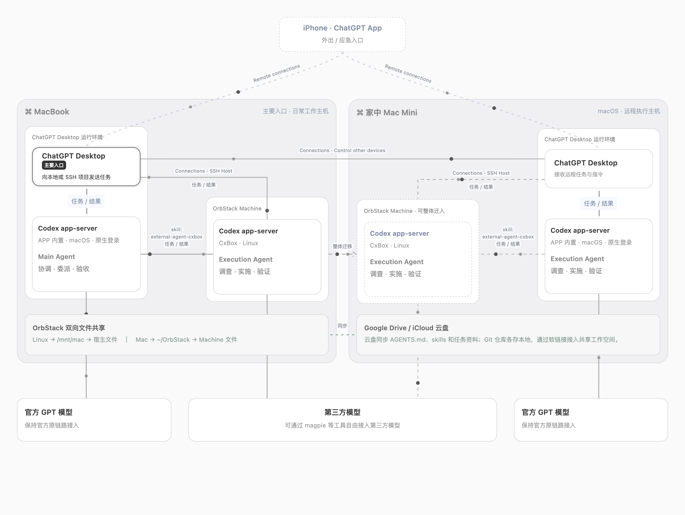

# Codexbox

**给你的 Main Agent 配一个助手。**

Codexbox 是一套基于 OrbStack Machines、Ubuntu 和 Codex CLI 的协作方案：你在熟悉的桌面端提出目标，Main Agent 负责规划、协调和验收；运行在 Linux 环境中的 Execution Agent 负责调查、实施和验证，并返回结果与证据。

它复用已有的远程连接、项目文件和工具，不需要为 Agent 协作另建通信协议或调度服务。远程会话、工具和模型的可用性取决于客户端、账号及实际配置。



图中展示一种多设备部署示例。虚线部分表示可选或规划中的部署方式；设备、云盘和模型接入可按实际需求调整。

## 如何协作

1. **明确目标**：Main Agent 确定工作目录、任务范围、授权边界和验收标准。
2. **委派执行**：Execution Agent 在独立会话中自主调查、修改和验证。任务契约包含必要上下文，不假定它继承了主会话的内容。
3. **依据证据验收**：Execution Agent 返回结论、实际变更、验证结果和未完成事项；Main Agent 核对关键证据后交付。

适合边界清晰、结果可独立验收的代码调查、批量分析、脚本开发和测试等任务。不同会话可能共享文件和 Git 状态，并发工作时应划分修改范围或使用独立工作区。

## 复用工作环境

Codexbox 使用 Linux 工具链，同时可按需复用 macOS 宿主资源：

| 方向 | 入口 | 用途 |
| --- | --- | --- |
| Linux → macOS | `/mnt/mac` | 访问宿主文件 |
| macOS → Linux | `~/OrbStack` | 浏览 Machine 文件 |
| Linux → macOS 服务 | `host.orb.internal` | 按端口访问宿主服务 |

实际读写和网络可达性取决于挂载、权限及监听配置。共享目录中的修改会直接影响原文件。默认 OrbStack 集成还可能提供宿主命令和 SSH agent 转发，**不构成独立安全沙箱**；使用前请评估权限，并按需选择 [OrbStack 隔离模式](https://docs.orbstack.dev/machines/isolated)。

执行端可以根据任务选择可用的模型服务，例如通过 Magpie 或其他兼容方式接入第三方模型。认证、数据处理、工具兼容性、质量和费用需分别评估；本仓库不预装或配置模型网关。

## 开始使用

需要 macOS、已安装并启动的 [OrbStack](https://orbstack.dev/) 和网络连接。获取仓库后，在项目目录运行初始化向导：

```bash
git clone https://github.com/cngarry/codexbox.git
cd codexbox

# 预览：选择 Machine、Ubuntu 版本和组件，不创建资源
bash scripts/init.sh

# 执行：重新选择组件，查看计划并确认后创建 Machine
bash scripts/init.sh --apply
```

向导可选安装基础工具包和 Codex CLI，默认 Machine 名称为 `cxbox`。它不会处理已有同名 Machine，也不会修改全局默认 Machine。安装失败时可能留下部分配置的 Machine，需检查状态并手动处理。详见[初始化向导](scripts/README.md)。

完成后可以进入 Machine：

```bash
orb -m cxbox
```

若选择了其他名称，请替换 `cxbox`。登录认证、模型配置和桌面客户端远程连接需要单独设置；建立连接后应确认目标 Machine、用户、文件访问和任务执行权限。具体支持以客户端和环境实际情况为准。

## Skills 与配置

- [external-agent-codexbox](skills/external-agent-codexbox/SKILL.md)：Main Agent 的委派、会话管理和验收指引。
- [agent-task-prompting](skills/agent-task-prompting/SKILL.md)：编写任务契约的配套 Skill，包含任务提示词模板。
- [配置示例](config/README.md)：Codex 用户级 `AGENTS.md` 和 DeepSeek 供应商配置示例。

使用 Skills 时，将以上两个目录按客户端的 Skill 安装方式安装或链接到其可发现的 skills 目录，并确认同名目标不会被覆盖。具体的远程项目发现、聊天创建、消息发送和等待能力及授权要求以客户端实际提供的工具为准。

配置示例不会由向导自动应用。修改前检查已有配置；不要把 API Key、SSH 私钥、登录态、会话数据或个人配置提交到仓库。

## 文档与验证

- [架构与协作](docs/architecture.md)
- [环境与安全边界](docs/environment.md)
- [初始化向导](scripts/README.md)
- [配置示例](config/README.md)

```bash
bash -n scripts/init.sh
bash -n tests/test-init.sh
bash tests/test-init.sh
```

测试使用模拟 OrbStack，不创建 Machine 或安装软件。实际安装、客户端连接、模型调用和断连恢复应在自己的环境中分别验证。

## 许可证

本仓库尚未指定开源许可证；使用、修改和分发权限以仓库后续明确的许可证为准。
